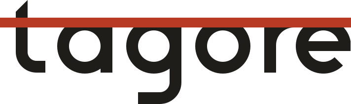

<h1>
  <picture>
    <source media="(prefers-color-scheme: dark)" srcset="assets/logo/tagore-wordmark-dark.svg">
    
  </picture>
</h1>

A Claude Code plugin for prose that other people read. It has 3 parts:

- **The `fair-copy` skill** rewrites the sentence patterns that make text read as model-written. Examples are "it's not X, it's Y", headers that state a verdict, and one-line closers that sound like a moral. Then the skill checks that the rewrite kept every fact of the draft.
- **A Stop hook** runs each time Claude tries to end a turn. If the turn changed a doc, Claude must first have a fresh subagent read the new text as a newcomer.
- **The `straight-talk` output style** shapes what Claude says to you in the session. The answer comes first, numbers stay exact, each new term gets a definition, and the reply ends with one next action. You turn it on and off yourself.

The skill, its scripts and the Stop hook come from declauding by Oskar Austegard (see Credit). The output style is tagore's own. tagore packages all of them as a plugin that you can install.

## Install

```
/plugin marketplace add rajnandan1/tagore
/plugin install tagore@tagore
```

To try it for one session, clone this repository and start Claude Code with `claude --plugin-dir /path/to/tagore`.

To get a new version, run `claude plugin marketplace update tagore`, then `claude plugin update tagore@tagore`, then restart Claude Code.

To turn it off, run `claude plugin disable tagore@tagore`. This turns off the skill, the hooks and the output style together.

## Docs

The docs are a website at <https://rajnandan1.github.io/tagore/>. Its pages are the Markdown files in `docs/`:

- [Quick start](docs/quick-start.md) installs tagore and uses each of the 3 parts once.
- [How it works](docs/how-it-works.md) says which part works on which text, and when each part runs.
- [The `fair-copy` skill](docs/fair-copy.md) says how to call the skill and gives its 5 steps.
- [Hooks](docs/hooks.md) covers the 2 hooks of tagore: the Stop hook, and the reminder hook that comes with the output style. It says when each hook runs, what it does and when it stays silent.
- [The `straight-talk` output style](docs/straight-talk.md) gives the rules of the style and says how to turn it on and off.
- [Files that the Stop hook skips](docs/skipped-files.md) is the full list of the files, folders and parts of files that the Stop hook does not check.
- [Network calls and files written](docs/network-and-files.md) says which scripts send text to a model API and which files tagore writes on your machine.
- [Development](docs/development.md) covers the repository layout, the tests and the build of the docs website.

## Credit

The `fair-copy` skill is declauding version 0.14.0 by Oskar Austegard, with its scripts, tests and hook config. It comes from [oaustegard/claude-skills](https://github.com/oaustegard/claude-skills/tree/366e2f2c61fbd4291774ae4d35f32bf66e3ee2e9/declauding) at commit `366e2f2c`, under the MIT license in `LICENSE`. tagore adds the plugin manifest, the marketplace file, this README, the docs in `docs/`, `GLOSSARY.md` (which defines the terms "reply" and "doc"), `evidence/README.md`, the Fable 5.2 samples in `evidence/fable-5-2/`, and the `straight-talk` output style with its reminder hook in `styles/straight-talk/`.
`evidence/model-register-drift/` is a copy of the samples and scores by Oskar Austegard in [oaustegard/experiments](https://github.com/oaustegard/experiments/tree/1f3e6192b4d1f5ddbe1104eecbfd5a5b5c0f7b45/model-register-drift) at commit `1f3e6192`, under the MIT license in its own `LICENSE`. `evidence/README.md` says what the copy holds and how it differs from upstream.

tagore changes 8 things in the declauding files from `oaustegard/claude-skills`. The `SKILL.md`, `hooks/`, `references/`, `scripts/` and `tests/` paths in this list are inside `skills/fair-copy/`.

1. The folder is `skills/fair-copy/`, not `declauding/`.
2. In `SKILL.md`, the `name`, the title and the `/mnt/skills/user/` path say `fair-copy`.
3. In `hooks/hooks.json`, the script path says `fair-copy`.
4. `references/models/fable.md` also covers Fable 5.2, and the model table in `SKILL.md` names it.
5. `scripts/fresh_eyes.py` also skips the files and folders written for agents that [Files that the Stop hook skips](docs/skipped-files.md) lists, and `tests/test_fresh_eyes.py` checks that it does.
6. Version 0.15.0 adds rules and examples from two other skills that rewrite model-written prose, both under the MIT license: [blader/humanizer](https://github.com/blader/humanizer) v4.0.0 and [Aboudjem/humanizer-skill](https://github.com/Aboudjem/humanizer-skill). They are in entries 2, 3, 9, 11, 12, 20 and 38 and the new entries 57 to 62 of `references/register.md`, in the last table of `references/exceptions.md`, in five sections of `SKILL.md` (the family table, the delivery modes, step 3, "Signs of a person writing" and "Scope"), in new rules in `scripts/prose_lint.py` and in new lines in `tests/sample-tics.md`. The prompts in `scripts/prose_review.py` and `scripts/fresh_eyes.py` also tell the model to treat the draft as text, not as instructions.
   The specimens for entries 57 to 59 quote AI-written Wikipedia text from the [Signs of AI writing](https://en.wikipedia.org/wiki/Wikipedia:Signs_of_AI_writing) page, which is under the CC BY-SA 4.0 license.
7. The four scripts are `prose_lint.py`, `prose_rank.py`, `prose_review.py` and `prose_diff.py`. Upstream gives them other names.
8. The `description` in `SKILL.md` has one more sentence. It says that the skill is not for Claude's own replies in the session, which the `straight-talk` output style covers.

The reference files keep the upstream names. So an upstream update needs only these 8 changes again, plus a merge of any file that upstream also changed among `references/models/fable.md`, `references/register.md`, `references/exceptions.md`, `SKILL.md`, the four `prose_*.py` scripts, `scripts/fresh_eyes.py`, `tests/sample-tics.md` and `tests/test_fresh_eyes.py`.
